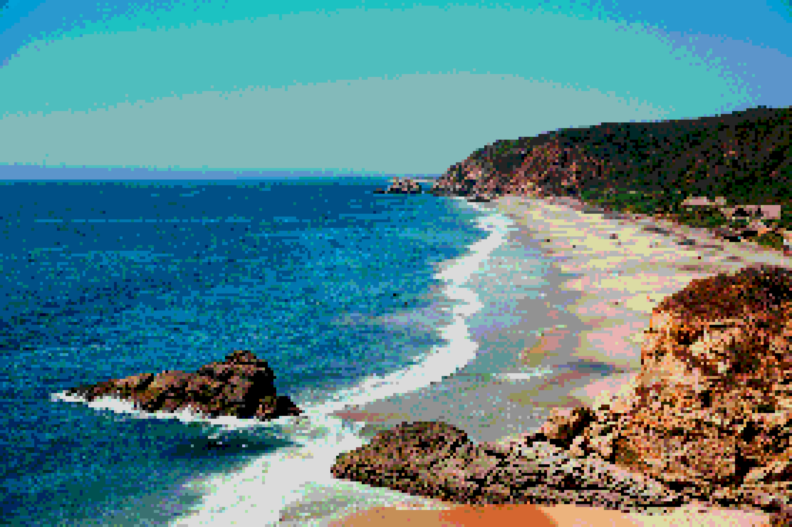
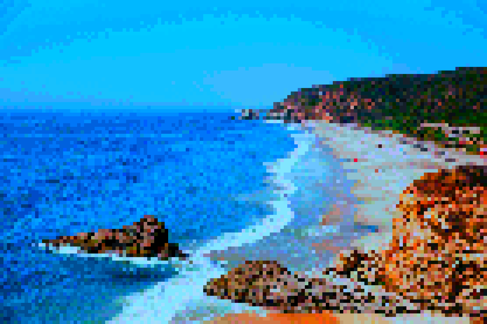
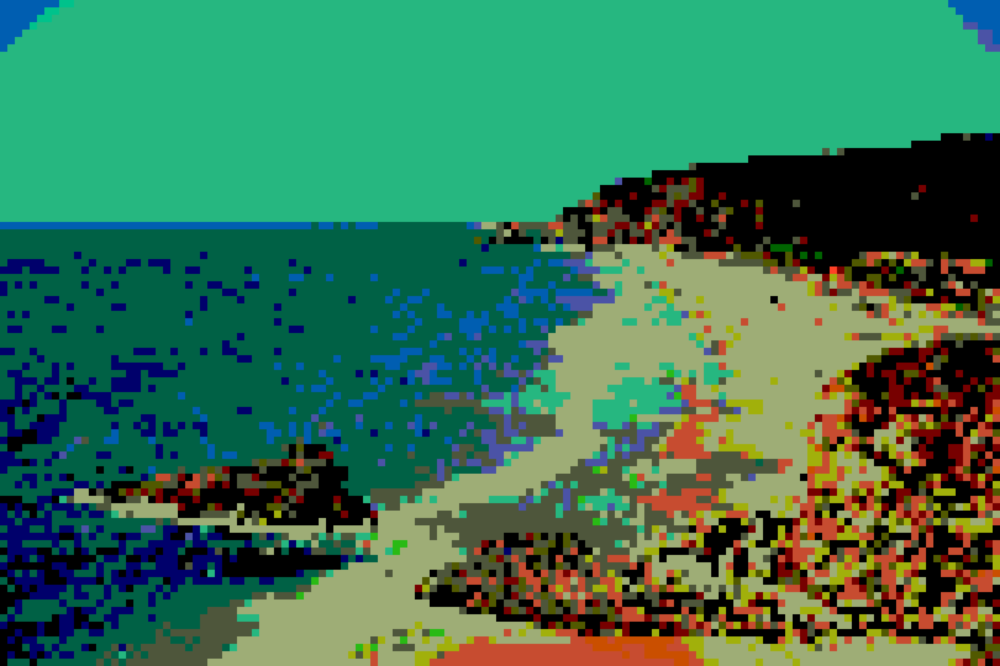
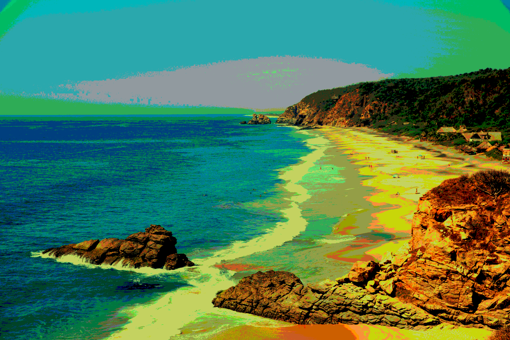
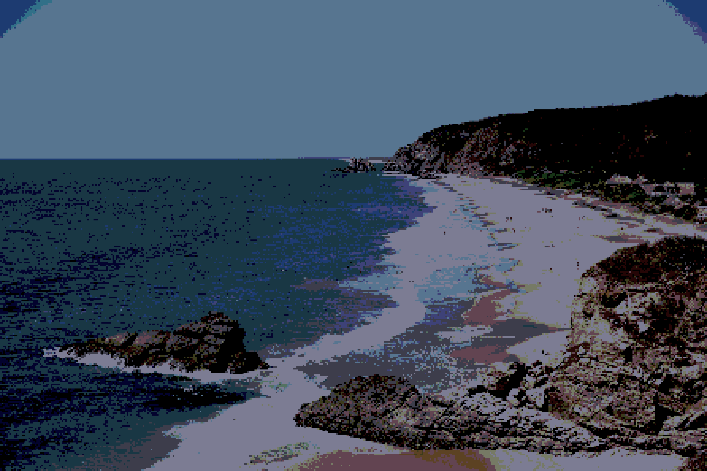

# Texture Tools
Texture tools is a retro-focused image editor made by Hoiby. 

## Table of Contents
- [Features](#features)
- [How to Use](#how-to-use)
- [Built With](#built-with)
- [Problems](#problems)

## Features
Texture tools has a small array of image effects such as:
- Pixelization: Shrink and then enlargen an image to pixelize it.
- Posterization: Limit the amount of colors in the image.
- Tint: Tint an image with a selected color.
- Greyscale: Pull the image's colors towards their grey value.
- Saturation: Push the images' colors away from their grey value.
- Brightness: Brighten and darken the image's midtones.
- Contrast: Change the distance between light and dark pixels.
- Threshold: Snap all pixels to black or white based on a threshold value.
- Hue: Rotate colors along the color wheel.

Effects can be reordered by dragging them around and are applied from top to bottom.

## How to Use
1. Go to https://hoiby01.github.io/texture-tools/.
2. Upload an image. (Be sure press submit image)
3. Adjust effect values until you're happy. Sliders only update after being released for performance.
4. Rearrange effect panels until you're happy by grabbing the headers.
5. Export the image.
6. If necessary, press reset effects to reset the panel settings, note it does not rearrange panels.

## Examples
The following are some examples of the effects this program can produce:

## Built With
This program was made with:
- Javascript
- HTML
- CSS

## Problems
Issues with this project:
- The interface probably doesn't resize across different resolutions. Use ctrl + scroll wheel to adjust scale until things look good.
- Effects are only applied after the slider or panel is done being moved because the effects aren't efficent enough to be updated in realtime.